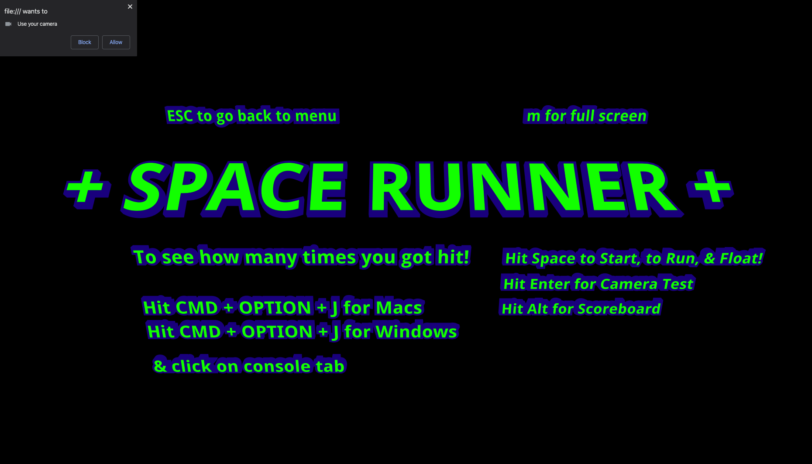
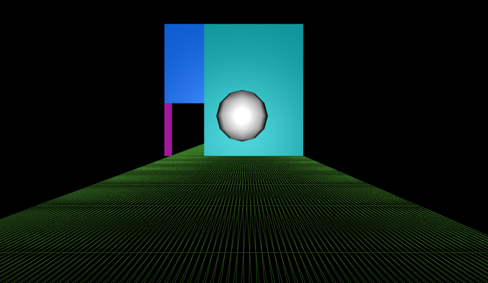

## FIRST PERSON ENDLESS RUNNER prototype with webcam motion capture using Machine Learning





## Tech Stack

**three.js** - design

**poseNet from ml5.js** - real time motion capture

**TensorFlow.js**

## Approach

Integrated three.js stack for designing endless runner with random wall generation.

Manually implemented and calculated algorithms for collision detection.

Needs to work on potentially implementing a user friendly collision feedback mechanism.

## To Run Application

1. git clone https://github.com/space-runner-prototype/space-runner.git in terminal
2. cd space-runner
3. npm i
4. npm run build
5. copy path of the index html onto your browser

## Dev Team

- Ricky Lau ([LinkedIn](https://www.linkedin.com/in/rickylaudev) | [GitHub](https://github.com/erick805))
- Alexander Mok ([LinkedIn](https://www.linkedin.com/in/mok-alexander/) | [GitHub](https://github.com/MistuhMok))

## Deterministic Course & Replay API

Walls are generated from a seeded 32-bit LCG (default seed `193`); each wall consumes three draws (magnitude, sign, width). The course is reproducible with `window.runnerDebug`:

- `resetCourse(seed = 193)` – rebuild the floor and ten walls, reset gameplay state, and enable manual mode
- `getCourse()` – `[{ index, z, holeX, holeWidth }]` in course order
- `getState()` – camera/head positions, `cameraSpeed`, `wallCount`, `wallsPassed`, `level`, `manualMode`
- `setManualMode(enabled)` – in manual mode the render loop does not advance gameplay
- `step(count)` – run exactly `count` (integer 1–10000) gameplay iterations and render once

```js
runnerDebug.resetCourse();
runnerDebug.step(400);
console.log(runnerDebug.getCourse(), runnerDebug.getState());
```

The initial course is built when `bundle.js` runs, so after changing `index.js` (or `Walls/singleHole.js`) rebuild it with `npm run build`, then start the server with `npm start` and open `http://localhost:8081/`.
